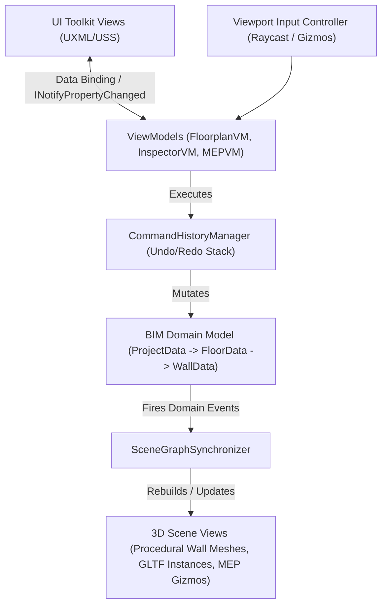
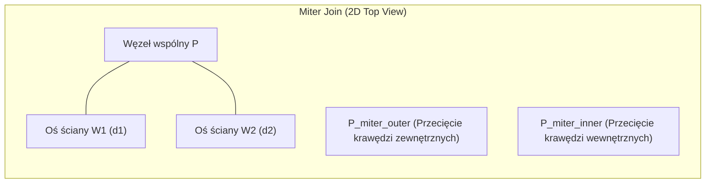

# System Design Document (SDD): 3DHomeBuildAndView (Unity 6 HDRP CAD/BIM & Real-Time Walkthrough)

> **Silnik docelowy:** Unity 6 (6000.0+ LTS) | **Render Pipeline:** High Definition Render Pipeline (HDRP) | **Język:** C# (.NET Standard 2.1 / C# 9.0+) | **UI Framework:** Unity UI Toolkit (UXML/USS)

---

## Spis Treści
1. [Rekomendowany Stos Technologiczny i Pakiety (UPM & Open Source)](#0-rekomendowany-stos-technologiczny-i-pakiety-upm--open-source)
2. [Moduł 1: Architektura Projektu, Zarządzanie Stanem (Command + MVVM) i Serializacja BIM](#moduł-1-architektura-projektu-i-zarządzanie-stanem-w-unity)
3. [Moduł 2: Algorytmy Generowania Geometrii (Procedural Mesh, Miter Joins, Otwory, Plane Slicing)](#moduł-2-algorytmy-generowania-geometrii-procedural-mesh--csg)
4. [Moduł 3: Runtime 3D Asset Importer i System Snappingu (Meble + MEP)](#moduł-3-runtime-3d-asset-importer-i-system-snappingu-c)
5. [Moduł 4: Konfiguracja Unity 6 HDRP i Tryb Spaceru (Walkthrough FPP)](#moduł-4-konfiguracja-unity-hdrp-i-tryb-spaceru-walkthrough)
6. [Moduł 5: Plan Implementacji (Roadmap MVP -> Full Product)](#moduł-5-plan-implementacji-roadmap-mvp---full-product)

---

## 0. Rekomendowany Stos Technologiczny i Pakiety (UPM & Open Source)

Zamiast pisać niskopoziomowe algorytmy od zera, architektura wykorzystuje sprawdzone biblioteki produkcyjne:

| Obszar funkcjonalny | Pakiet / Biblioteka | Identyfikator UPM / Źródło | Zastosowanie w projekcie |
| :--- | :--- | :--- | :--- |
| **Rendering** | Unity HDRP (Unity 6) | `com.unity.render-pipelines.high-definition` | SSGI, Ray Tracing (DXR), Adaptive Probe Volumes (APV), Physical Sky |
| **Kamery** | Cinemachine 3.x | `com.unity.cinemachine` | Płynne przejścia między kamerą 2D Ortho, 3D Orbit, 2D Elevation i FPP |
| **System Wejścia** | Input System | `com.unity.inputsystem` | Mapowanie skrótów CAD (`Ctrl+Z`, `Ctrl+Y`, `Shift` dla blokady osi) oraz sterowania FPP |
| **Import glTF/GLB** | Unity glTFast | `com.unity.cloud.gltfast` | Asynchroniczny import modeli `.glb`/`.gltf` w Runtime z automatyczną konwersją materiałów do HDRP Lit |
| **Import FBX/OBJ/DXF** | AssimpNet / TriLib 2 + netDxf | NuGet `AssimpNet` / `netDxf` | Wczytywanie rzutów wektorowych `.dxf` (`netDxf`) oraz modeli `.fbx`/`.obj` w Runtime |
| **Triangulacja 2D** | LibTessDotNet / Clipper2 | NuGet `LibTessDotNet` + `Clipper2` | Operacje boolowskie 2D (offset ścian, wycinanie otworów okiennych w rzucie 2D ściany) i triangulacja z dziurami |
| **CSG / Slicing 3D** | EzySlice / Chisel / pb_CSG | Open Source (`EzySlice`) | Przycinanie siatek 3D ścian płaszczyzną połaci dachowej (`Plane Slicing`) |
| **Gizma 3D w Runtime** | RuntimeTransformHandle | GitHub (`pshtif/RuntimeTransformHandle`) | Przesuwanie, obracanie i skalowanie mebli na scenie w skompilowanej aplikacji |
| **Serializacja JSON** | Newtonsoft Json.NET | `com.unity.nuget.newtonsoft-json` | Polimorficzna serializacja drzewa BIM, obsługa `Guid` oraz własnych konwerterów `Vector2`/`Vector3` |
| **Okna dialogowe OS** | StandaloneFileBrowser | GitHub (`gkngkc/UnityStandaloneFileBrowser`) | Natywne okno wyboru pliku Windows/macOS dla importu rzutów PNG/DXF i modeli 3D |
| **Matematyka SIMD** | Unity Mathematics + Burst | `com.unity.mathematics`, `com.unity.burst` | Szybkie operacje wektorowe (`float2`, `float3`), przecięcia prostych i przeliczanie siatek |

---

## Moduł 1: Architektura Projektu i Zarządzanie Stanem w Unity

### 1.1. Architektura Wysokopoziomowa (MVVM + Command Pattern + Reactive Event Bus)

Aplikacja oddziela **Model Danych BIM** (czyste klasy C# POCO, niezależne od `MonoBehaviour`) od **Warstwy Prezentacji 3D** (`WallView`, `FurnitureView`, `MEPNodeView`) oraz **UI Toolkit (MVVM)**. Każda zmiana stanu projektu przechodzi wyłącznie przez `CommandHistoryManager`.



### 1.2. Wzorzec Command Pattern (Obsługa `Ctrl+Z` / `Ctrl+Y` oraz Transakcji)

Podczas przeciągania ściany lub przesuwania szafki myszką nie chcemy odkładać na stos 60 komend na sekundę. Wprowadzamy rozróżnienie na:
- `IProjectCommand` – pojedyncza operacja atomowa.
- `ICompositeCommand` – transakcja grupująca wiele operacji (np. wstawienie okna + modyfikacja ściany + usunięcie kolidującego gniazdka).
- **Continuous Drag Pattern:** podczas `OnDrag` obiekt jest aktualizowany w trybie podglądu (`Preview`), a dopiero na `OnEndDrag` rejestrowana jest komenda ze stanem `InitialState` i `FinalState`.

```csharp
using System;
using System.Collections.Generic;
using UnityEngine;

namespace HomeBuilder.Core.Commands
{
    public interface IProjectCommand
    {
        Guid CommandId { get; }
        string Description { get; }
        void Execute();
        void Undo();
        bool TryMerge(IProjectCommand nextCommand); // Łączenie drobnych zmian (np. wpisywanie wymiaru z klawiatury)
    }

    public sealed class CommandHistoryManager
    {
        private readonly Stack<IProjectCommand> _undoStack = new();
        private readonly Stack<IProjectCommand> _redoStack = new();
        private readonly int _maxHistorySize;

        public event Action OnHistoryChanged;

        public bool CanUndo => _undoStack.Count > 0;
        public bool CanRedo => _redoStack.Count > 0;

        public CommandHistoryManager(int maxHistorySize = 200)
        {
            _maxHistorySize = maxHistorySize;
        }

        public void ExecuteCommand(IProjectCommand command)
        {
            if (command == null) throw new ArgumentNullException(nameof(command));

            command.Execute();

            if (_undoStack.Count > 0 && _undoStack.Peek().TryMerge(command))
            {
                _redoStack.Clear();
                OnHistoryChanged?.Invoke();
                return;
            }

            _undoStack.Push(command);
            _redoStack.Clear();
            TrimHistoryIfNeeded();
            OnHistoryChanged?.Invoke();
        }

        public void Undo()
        {
            if (!CanUndo) return;
            IProjectCommand cmd = _undoStack.Pop();
            cmd.Undo();
            _redoStack.Push(cmd);
            OnHistoryChanged?.Invoke();
        }

        public void Redo()
        {
            if (!CanRedo) return;
            IProjectCommand cmd = _redoStack.Pop();
            cmd.Execute();
            _undoStack.Push(cmd);
            OnHistoryChanged?.Invoke();
        }

        private void TrimHistoryIfNeeded()
        {
            if (_undoStack.Count <= _maxHistorySize) return;
            var temp = _undoStack.ToArray();
            _undoStack.Clear();
            for (int i = _maxHistorySize - 1; i >= 0; i--)
            {
                _undoStack.Push(temp[i]);
            }
        }
    }

    /// <summary>
    /// Przykład komendy dodającej ścianę i automatycznie przeliczającej połączenia narożników (Miter Joins).
    /// </summary>
    public sealed class CreateWallCommand : IProjectCommand
    {
        public Guid CommandId { get; } = Guid.NewGuid();
        public string Description => "Create Wall";

        private readonly Data.FloorData _floor;
        private readonly Data.WallData _wallData;
        private readonly Action<Data.FloorData> _onFloorTopologyChanged;

        public CreateWallCommand(
            Data.FloorData floor,
            Data.WallData wallData,
            Action<Data.FloorData> onFloorTopologyChanged)
        {
            _floor = floor;
            _wallData = wallData;
            _onFloorTopologyChanged = onFloorTopologyChanged;
        }

        public void Execute()
        {
            _floor.Walls.Add(_wallData);
            _onFloorTopologyChanged?.Invoke(_floor);
        }

        public void Undo()
        {
            _floor.Walls.Remove(_wallData);
            _onFloorTopologyChanged?.Invoke(_floor);
        }

        public bool TryMerge(IProjectCommand nextCommand) => false;
    }
}
```

### 1.3. Integracja MVVM z Unity UI Toolkit

Unity 6 wspiera natywny **Runtime Data Binding** w UI Toolkit (`INotifyBindablePropertyChanged`). ViewModele implementują ten interfejs, dzięki czemu pola tekstowe wymiarów (`FloatField` dla wysokości ściany, odległości gniazdka od narożnika) aktualizują się dwukierunkowo bez narzutu GC.

```csharp
using System.Runtime.CompilerServices;
using Unity.Properties;
using UnityEngine.UIElements;
using HomeBuilder.Core.Commands;

namespace HomeBuilder.UI.ViewModels
{
    public abstract class ViewModelBase : INotifyBindablePropertyChanged
    {
        public event EventCallback<BindablePropertyChangedEventArgs> propertyChanged;

        protected void Notify([CallerMemberName] string propertyName = "")
        {
            propertyChanged?.Invoke(this, new BindablePropertyChangedEventArgs(propertyName));
        }
    }

    public sealed class WallInspectorViewModel : ViewModelBase
    {
        private readonly CommandHistoryManager _commandHistory;
        private Data.WallData _selectedWall;

        public WallInspectorViewModel(CommandHistoryManager commandHistory)
        {
            _commandHistory = commandHistory;
        }

        [CreateProperty]
        public float WallThickness
        {
            get => _selectedWall?.Thickness ?? 0.24f;
            set
            {
                if (_selectedWall == null || Mathf.Approximately(_selectedWall.Thickness, value)) return;
                _commandHistory.ExecuteCommand(
                    new PropertyChangeCommand<float>(
                        "Change Wall Thickness",
                        _selectedWall.Thickness,
                        Mathf.Clamp(value, 0.05f, 1.0f),
                        val => { _selectedWall.Thickness = val; Notify(); }
                    )
                );
            }
        }
    }
}
```

### 1.4. Kompletna Struktura Klas C# do Serializacji Projektu (JSON Save/Load BIM)

Poniższa hierarchia klas obsługuje:
- Wiele kondygnacji (`FloorData`), w tym poddasze z połaciami dachowymi (`RoofPlaneData`) i ścianką kolankową (`KneeWallHeight`).
- Kalibrację podkładu 2D (`BlueprintReferenceData` – ścieżka do pliku PNG/DXF, piksele-na-metr, offset).
- Ściany (`WallData`), otwory okienne/drzwiowe (`OpeningData`), instalacje MEP (`MEPData` wraz z powiązaniami `SwitchToLightLinks`) oraz meble (`FurnitureData` z obsługą zewnętrznych plików `.glb`).

```csharp
using System;
using System.Collections.Generic;
using Newtonsoft.Json;
using UnityEngine;

namespace HomeBuilder.Data
{
    [Serializable]
    public sealed class ProjectData
    {
        public string SchemaVersion { get; set; } = "1.0.0";
        public Guid ProjectId { get; set; } = Guid.NewGuid();
        public string ProjectName { get; set; } = "Nowy Projekt Domu";
        public DateTime LastModifiedUtc { get; set; } = DateTime.UtcNow;
        public EnvironmentSettingsData Environment { get; set; } = new();
        public List<FloorData> Floors { get; set; } = new();
        public List<CustomAssetManifestEntry> CustomAssetLibrary { get; set; } = new();
    }

    [Serializable]
    public sealed class EnvironmentSettingsData
    {
        public float TimeOfDayHours { get; set; } = 14.5f; // 14:30
        public float NorthAngleDegrees { get; set; } = 0f;
        public float Latitude { get; set; } = 52.2297f; // Warszawa
        public float Longitude { get; set; } = 21.0122f;
    }

    [Serializable]
    public sealed class FloorData
    {
        public Guid FloorId { get; set; } = Guid.NewGuid();
        public string Name { get; set; } = "Parter";
        public int LevelIndex { get; set; } = 0;
        public float ElevationY { get; set; } = 0.0f;           // Rzędna podłogi względem 0.0m
        public float DefaultCeilingHeight { get; set; } = 2.75f; // Domyślna wysokość kondygnacji
        public float SlabThickness { get; set; } = 0.25f;        // Grubość stropu
        public bool IsAttic { get; set; } = false;               // Czy kondygnacja to poddasze użytkowe
        public float KneeWallHeight { get; set; } = 1.10f;       // Wysokość ścianki kolankowej (m)

        public BlueprintReferenceData Blueprint { get; set; } = new();
        public List<WallData> Walls { get; set; } = new();
        public List<RoomData> Rooms { get; set; } = new();
        public List<RoofPlaneData> RoofPlanes { get; set; } = new();
        public List<FurnitureData> Furnitures { get; set; } = new();
        public List<MEPConnectionLink> MEPLinks { get; set; } = new(); // Połączenia Włącznik -> Punkt świetlny
    }

    [Serializable]
    public sealed class BlueprintReferenceData
    {
        public string FilePath { get; set; } = string.Empty; // Względna lub bezwzględna ścieżka do PNG/JPG/DXF
        public bool IsVisible { get; set; } = true;
        public float Opacity { get; set; } = 0.65f;
        public float MetersPerPixel { get; set; } = 0.01f;   // Wyliczone z kalibracji 2-punktowej
        public SerializableVector2 WorldOffset { get; set; } = new(0f, 0f);
        public float RotationDegrees { get; set; } = 0f;
    }

    [Serializable]
    public sealed class RoomData
    {
        public Guid RoomId { get; set; } = Guid.NewGuid();
        public string Name { get; set; } = "Salon";
        public List<Guid> BoundaryWallIds { get; set; } = new();
        public List<SerializableVector2> PolygonVertices2D { get; set; } = new(); // Zamknięty wielokąt podłogi
        public string FloorMaterialId { get; set; } = "mat_oak_parquet";
        public string CeilingMaterialId { get; set; } = "mat_white_plaster";
        public List<MEPData> CeilingMEPItems { get; set; } = new(); // Punkty świetlne na suficie
    }

    [Serializable]
    public sealed class WallData
    {
        public Guid WallId { get; set; } = Guid.NewGuid();
        public SerializableVector2 StartPoint { get; set; } // Współrzędne X, Z w płaszczyźnie kondygnacji
        public SerializableVector2 EndPoint { get; set; }
        public float Thickness { get; set; } = 0.24f;       // 24cm ściana nośna / 12cm działowa
        public float BaseHeight { get; set; } = 2.75f;
        public bool IsLoadBearing { get; set; } = true;
        public bool ClipByRoofPlanes { get; set; } = true;  // Czy ścinać połacią dachu na poddaszu

        public string FrontMaterialId { get; set; } = "mat_wall_white";
        public string BackMaterialId { get; set; } = "mat_wall_white";
        public string EdgeMaterialId { get; set; } = "mat_wall_concrete";

        public List<OpeningData> Openings { get; set; } = new();
        public List<MEPData> MountedMEPItems { get; set; } = new();
    }

    public enum OpeningType { DoorSingle, DoorDouble, WindowStandard, WindowRoof, WallOpeningPassThrough }

    [Serializable]
    public sealed class OpeningData
    {
        public Guid OpeningId { get; set; } = Guid.NewGuid();
        public OpeningType Type { get; set; } = OpeningType.WindowStandard;
        public float DistanceFromWallStart { get; set; } = 1.0f; // Odległość środka otworu od StartPoint ściany (w metrach)
        public float Width { get; set; } = 1.20f;
        public float Height { get; set; } = 1.50f;
        public float SillHeight { get; set; } = 0.85f;           // Wysokość parapetu (0.0m dla drzwi)
        public bool FlipHorizontal { get; set; } = false;
        public bool FlipInward { get; set; } = true;
        public string PrefabAssetId { get; set; } = "window_double_tilt";
    }

    public enum MEPCategory
    {
        ElectricalSocket230V,
        ElectricalSocket400V,
        LightSwitchSingle,
        LightSwitchDouble,
        CeilingLightPoint,
        WallLightPoint,
        WaterSupplyCold,
        WaterSupplyHot,
        SewageDrain50mm,
        SewageDrain110mm
    }

    [Serializable]
    public sealed class MEPData
    {
        public Guid MEPId { get; set; } = Guid.NewGuid();
        public MEPCategory Category { get; set; } = MEPCategory.ElectricalSocket230V;
        public Guid HostSurfaceId { get; set; }                  // WallId lub RoomId (dla sufitu)
        public int WallSide { get; set; } = 1;                   // +1 (strona przednia normalnej) lub -1 (tylna)
        public float DistanceAlongWall { get; set; } = 0.50f;    // Pozycja wzdłuż osi ściany (m)
        public float ElevationFromFloor { get; set; } = 0.30f;   // Domyślnie 0.30m (gniazdko) lub 1.10m (włącznik/blat)
        public SerializableVector3 WorldPosition { get; set; }
        public SerializableVector3 SurfaceNormal { get; set; }
        public float SafetyZoneRadius { get; set; } = 0.15f;     // Strefa ochronna do detekcji kolizji (np. zmywarka/zlewozmywak)
        public string PrefabAssetId { get; set; } = "mep_socket_single";
    }

    [Serializable]
    public sealed class MEPConnectionLink
    {
        public Guid LinkId { get; set; } = Guid.NewGuid();
        public Guid SwitchMEPId { get; set; }
        public Guid TargetLightMEPId { get; set; }
        public int SwitchButtonIndex { get; set; } = 0; // Obsługa włączników dwuklawiszowych
    }

    [Serializable]
    public sealed class RoofPlaneData
    {
        public Guid RoofPlaneId { get; set; } = Guid.NewGuid();
        public SerializableVector2 EaveStart { get; set; }       // Początek linii okapu / ścianki kolankowej
        public SerializableVector2 EaveEnd { get; set; }         // Koniec linii okapu
        public float EaveElevationY { get; set; } = 1.10f;       // Wysokość startowa połaci (ścianka kolankowa)
        public float PitchAngleDegrees { get; set; } = 38.0f;    // Kąt nachylenia dachu (np. 35-45 stopni)
        public float Thickness { get; set; } = 0.30f;
    }

    [Serializable]
    public sealed class FurnitureData
    {
        public Guid InstanceId { get; set; } = Guid.NewGuid();
        public string CatalogOrCustomAssetId { get; set; }
        public bool IsExternalCustomModel { get; set; } = false;
        public SerializableVector3 Position { get; set; }
        public SerializableVector3 RotationEuler { get; set; }
        public SerializableVector3 Scale { get; set; } = new(1f, 1f, 1f);
        public Guid? SnappedWallId { get; set; }
        public bool HasApplianceExclusionZone { get; set; } = false; // Np. Zmywarka - zakaz gniazdek bezpośrednio za nią
        public Dictionary<string, string> MaterialOverrides { get; set; } = new();
    }

    [Serializable]
    public sealed class CustomAssetManifestEntry
    {
        public string AssetId { get; set; }
        public string OriginalFileName { get; set; }
        public string RelativeLocalPath { get; set; } // Np. "ImportedAssets/szafka_60.glb"
        public SerializableVector3 NormalizedBoundsSize { get; set; }
        public SerializableVector3 PivotOffsetApplied { get; set; }
    }

    [Serializable]
    public struct SerializableVector2
    {
        public float X;
        public float Y;
        public SerializableVector2(float x, float y) { X = x; Y = y; }
        public Vector2 ToVector2() => new(X, Y);
        public static implicit operator SerializableVector2(Vector2 v) => new(v.x, v.y);
    }

    [Serializable]
    public struct SerializableVector3
    {
        public float X;
        public float Y;
        public float Z;
        public SerializableVector3(float x, float y, float z) { X = x; Y = y; Z = z; }
        public Vector3 ToVector3() => new(X, Y, Z);
        public static implicit operator SerializableVector3(Vector3 v) => new(v.x, v.y, v.z);
    }
}
```

### 1.5. Kalibracja Skali Rzutu 2D (1 Jednostka Unity = 1 Metr)

Gdy użytkownik wgrywa rzut `PNG/JPG` o wymiarach $(W_{px}, H_{px})$ i klika na nim dwa punkty w przestrzeni UV tekstury $(p_1, p_2)$ oraz wpisuje rzeczywisty wymiar w metrach $L_{real}$:
1. Odległość w pikselach wynosi:
   $$d_{px} = \sqrt{((p_{2x} - p_{1x}) \cdot W_{px})^2 + ((p_{2y} - p_{1y}) \cdot H_{px})^2}$$
2. Współczynnik skali wynosi:
   $$\text{MetersPerPixel} = \frac{L_{real}}{d_{px}}$$
3. Quad podkładu w przestrzeni świata Unity otrzymuje skalę:
   $$\text{QuadScale} = (W_{px} \cdot \text{MetersPerPixel}, \; 1, \; H_{px} \cdot \text{MetersPerPixel})$$

---

## Moduł 2: Algorytmy Generowania Geometrii (Procedural Mesh & CSG)

### 2.1. Matematyka Ściany, Łączenie Narożników (Miter Joins) i Mapowanie UV w Skali Świata

Każda ściana posiada linię osiową (rdzeniową) w płaszczyźnie $XZ$ zdefiniowaną przez $A = \text{Start} \in \mathbb{R}^2$ oraz $B = \text{End} \in \mathbb{R}^2$, grubość $t$ oraz wysokość bazową $H$.

#### Wyznaczenie Wektorów Kierunkowych i Normalnych (2D)
- Wektor kierunkowy osi ściany:
  $$\vec{d} = \frac{B - A}{\|B - A\|}$$
- Wektor normalny ściany (skierowany w "lewo" względem kierunku rysowania):
  $$\vec{n} = (-d_y, d_x)$$
- Bez połączenia narożnikowego (ściana wolnostojąca), cztery narożniki podstawy ściany w rzucie 2D to:
  $$A_L = A + \vec{n} \frac{t}{2}, \quad A_R = A - \vec{n} \frac{t}{2}$$
  $$B_L = B + \vec{n} \frac{t}{2}, \quad B_R = B - \vec{n} \frac{t}{2}$$

#### Algorytm Miter Join (Łączenie Ścian pod Dowolnym Kątem)
Gdy ściana $W_1$ (kierunek $\vec{d}_1$ od węzła wspólnego $P$, normalna $\vec{n}_1$, grubość $t_1$) łączy się w punkcie $P$ ze ścianą $W_2$ (kierunek $\vec{d}_2$ od węzła $P$, normalna $\vec{n}_2$, grubość $t_2$):

1. Wyznaczamy odsunięte proste krawędzi zewnętrznych i wewnętrznych obu ścian:
   - Prosta krawędzi 1: $L_1(s) = (P + \vec{n}_1 \frac{t_1}{2}) + s \cdot \vec{d}_1$
   - Prosta krawędzi 2: $L_2(u) = (P - \vec{n}_2 \frac{t_2}{2}) + u \cdot \vec{d}_2$ *(zależnie od orientacji cyrkulacji wokół węzła)*
2. Szukamy punktu przecięcia dwóch prostych 2D:
   $$P_1 + s \cdot \vec{d}_1 = P_2 + u \cdot \vec{d}_2$$
   Używając dwuwymiarowego iloczynu wektorowego $\text{cross}(u, v) = u_x v_y - u_y v_x$:
   $$\Delta = \text{cross}(\vec{d}_1, \vec{d}_2)$$
   Jeśli $|\Delta| > \varepsilon$:
   $$s = \frac{\text{cross}(P_2 - P_1, \vec{d}_2)}{\Delta}, \quad P_{\text{miter}} = P_1 + s \cdot \vec{d}_1$$
3. **Miter Limit (Zabezpieczenie przed ostrymi kątami $< 20^\circ$):**
   Jeśli $\|P_{\text{miter}} - P\| > \text{MiterLimit} \cdot \max(t_1, t_2)$ (gdzie $\text{MiterLimit} \approx 2.5$), zamiast szpilkowego narożnika stosujemy ścięcie fazowe (**Bevel Join**).



#### World-Space UV Mapping (Brak Rozciągania Tekstur)
Aby tekstura cegły lub płytek o wymiarze rzeczywistym $1\text{m} \times 1\text{m}$ nigdy nie była rozciągnięta niezależnie od długości ściany i wyciętych okien:
Dla każdego wierzchołka $V = (x, y, z) \in \mathbb{R}^3$ należącego do ściany o stycznej poziomej $\vec{T} = (d_x, 0, d_y)$ i normalnej $\vec{N}$:
- Dla powierzchni bocznych (przedniej i tylnej):
  $$u = \text{dot}(V - V_{\text{origin}}, \vec{T}), \quad v = V_y$$
- Dla glifów okiennych/drzwiowych oraz krawędzi bocznych:
  $$u = \text{dot}(V - V_{\text{origin}}, \vec{N}), \quad v = V_y \text{ (pionowe)} \quad \text{lub} \quad u = \text{dot}(V - V_{\text{origin}}, \vec{T}), \quad v = \text{dot}(V - V_{\text{origin}}, \vec{N}) \text{ (poziome nadproże/parapet)}$$

---

### 2.2. Wycinanie Otworów (Okna i Drzwi) oraz Ścinanie Ścian Połacią Dachu (Plane Slicing)

Zamiast ciężkiego i podatnego na błędy topologiczne pełnego 3D CSG na siatkach trójkątnych, w systemach BIM/CAD najwydajniejszym i dającym idealnie czystą siatkę rozwiązaniem jest **Hybrydowy Pipeline 2.5D + 3D Plane Slicing**:

1. **Krok 1 (Profil 2D Ściany + Ścięcie Dachem w Płaszczyźnie Ściany):**
   - Zaczynamy od prostokąta ściany w jej lokalnym układzie 2D $(u, y)$: $u \in [0, L]$, $y \in [0, H]$.
   - Jeśli ściana znajduje się na poddaszu (`ClipByRoofPlanes == true`), każda połać dachowa jest reprezentowana w przestrzeni 3D przez płaszczyznę $\Pi_{\text{roof}}: \vec{N}_{\text{roof}} \cdot (X - X_0) = 0$, gdzie $\vec{N}_{\text{roof}}$ jest skierowany do wnętrza poddasza (w dół).
   - Przycinamy górny wielokąt ściany algorytmem **Sutherland-Hodgman 3D Plane Clipping** dla każdej płaszczyzny połaci dachowej przed wytłoczeniem lub bezpośrednio na wygenerowanym graniastosłupie ściany.
2. **Krok 2 (Wycinanie Otworów Okiennych i Drzwiowych):**
   - Otwory `OpeningData` to prostokąty wewnętrzne (dziury):
     $$u \in \left[d_{\text{open}} - \frac{w}{2}, \; d_{\text{open}} + \frac{w}{2}\right], \quad y \in [y_{\text{sill}}, \; y_{\text{sill}} + h]$$
   - Wielokąt zewnętrzny ściany wraz z listą prostokątnych dziur przekazujemy do **Constrained Delaunay Triangulation / LibTessDotNet** (lub dzielimy ścianę na pasy pionowe/poziome wokół otworów), a następnie generujemy:
     - Lico przednie (przesunięte o $+\vec{n}\frac{t}{2}$ z uwzględnieniem interpolacji narożników Miter na krańcach $u=0$ i $u=L$),
     - Lico tylne (przesunięte o $-\vec{n}\frac{t}{2}$ z odwróconą kolejnością indeksów trójkątów),
     - Wewnętrzne ościeża (glify) wokół każdego otworu łączące lico przednie z tylnym.

### 2.3. Kompletny Generator Siatki Ściany w C# (`ProceduralWallMeshBuilder.cs`)

```csharp
using System;
using System.Collections.Generic;
using UnityEngine;
using HomeBuilder.Data;

namespace HomeBuilder.Geometry
{
    public struct WallCornerMiter
    {
        public Vector2 StartLeft;
        public Vector2 StartRight;
        public Vector2 EndLeft;
        public Vector2 EndRight;
    }

    public static class ProceduralWallMeshBuilder
    {
        private const float MiterLimitMultiplier = 2.5f;
        private const float Epsilon = 1e-5f;

        /// <summary>
        /// Oblicza punkty narożne ściany w rzucie 2D (XZ) z uwzględnieniem połączeń Miter Join.
        /// </summary>
        public static WallCornerMiter ComputeMiterCorners(
            WallData wall,
            WallData prevConnectedAtStart,
            WallData nextConnectedAtEnd)
        {
            Vector2 a = wall.StartPoint.ToVector2();
            Vector2 b = wall.EndPoint.ToVector2();
            Vector2 dir = (b - a).normalized;
            Vector2 normal = new Vector2(-dir.y, dir.x);
            float halfT = wall.Thickness * 0.5f;

            var result = new WallCornerMiter
            {
                StartLeft = a + normal * halfT,
                StartRight = a - normal * halfT,
                EndLeft = b + normal * halfT,
                EndRight = b - normal * halfT
            };

            if (prevConnectedAtStart != null)
            {
                Vector2 otherDir = GetOutgoingDirectionFromNode(prevConnectedAtStart, a);
                Vector2 otherNormal = new Vector2(-otherDir.y, otherDir.x);
                float otherHalfT = prevConnectedAtStart.Thickness * 0.5f;

                if (TryIntersectLines2D(
                    result.StartLeft, dir,
                    a - otherNormal * otherHalfT, otherDir,
                    out Vector2 miterLeft) &&
                    Vector2.Distance(a, miterLeft) <= wall.Thickness * MiterLimitMultiplier)
                {
                    result.StartLeft = miterLeft;
                }

                if (TryIntersectLines2D(
                    result.StartRight, dir,
                    a + otherNormal * otherHalfT, otherDir,
                    out Vector2 miterRight) &&
                    Vector2.Distance(a, miterRight) <= wall.Thickness * MiterLimitMultiplier)
                {
                    result.StartRight = miterRight;
                }
            }

            if (nextConnectedAtEnd != null)
            {
                Vector2 otherDir = GetOutgoingDirectionFromNode(nextConnectedAtEnd, b);
                Vector2 otherNormal = new Vector2(-otherDir.y, otherDir.x);
                float otherHalfT = nextConnectedAtEnd.Thickness * 0.5f;

                if (TryIntersectLines2D(
                    result.EndLeft, -dir,
                    b + otherNormal * otherHalfT, otherDir,
                    out Vector2 miterEndLeft) &&
                    Vector2.Distance(b, miterEndLeft) <= wall.Thickness * MiterLimitMultiplier)
                {
                    result.EndLeft = miterEndLeft;
                }

                if (TryIntersectLines2D(
                    result.EndRight, -dir,
                    b - otherNormal * otherHalfT, otherDir,
                    out Vector2 miterEndRight) &&
                    Vector2.Distance(b, miterEndRight) <= wall.Thickness * MiterLimitMultiplier)
                {
                    result.EndRight = miterEndRight;
                }
            }

            return result;
        }

        /// <summary>
        /// Generuje 3-submeshową siatkę ściany (0: Front, 1: Back, 2: Edges/Reveals) z otworami oraz ścięciem poddasza.
        /// </summary>
        public static Mesh GenerateWallMesh(
            WallData wall,
            WallCornerMiter miter,
            IReadOnlyList<Plane> roofClippingPlanes)
        {
            Vector2 a = wall.StartPoint.ToVector2();
            Vector2 b = wall.EndPoint.ToVector2();
            float length = Vector2.Distance(a, b);
            if (length < Epsilon) return new Mesh();

            var vertices = new List<Vector3>(128);
            var normals = new List<Vector3>(128);
            var uvs = new List<Vector2>(128);
            var frontTris = new List<int>(64);
            var backTris = new List<int>(64);
            var edgeTris = new List<int>(64);

            // Sortujemy otwory wzdłuż ściany od Start do End
            var sortedOpenings = new List<OpeningData>(wall.Openings);
            sortedOpenings.Sort((x, y) => x.DistanceFromWallStart.CompareTo(y.DistanceFromWallStart));

            // Dzielimy ścianę wzdłuż osi U [0, length] na segmenty pełne i segmenty z otworami
            float cursorU = 0f;
            foreach (var op in sortedOpenings)
            {
                float opStart = Mathf.Clamp(op.DistanceFromWallStart - op.Width * 0.5f, 0f, length);
                float opEnd = Mathf.Clamp(op.DistanceFromWallStart + op.Width * 0.5f, 0f, length);

                if (opStart > cursorU + Epsilon)
                {
                    AddWallSpanSegment(
                        cursorU, opStart, 0f, wall.BaseHeight,
                        length, miter, roofClippingPlanes,
                        vertices, normals, uvs, frontTris, backTris, edgeTris,
                        closeLeft: cursorU <= Epsilon, closeRight: false, closeBottom: true, closeTop: true);
                }

                // Podproże (pod oknem)
                if (op.SillHeight > Epsilon)
                {
                    AddWallSpanSegment(
                        opStart, opEnd, 0f, op.SillHeight,
                        length, miter, roofClippingPlanes,
                        vertices, normals, uvs, frontTris, backTris, edgeTris,
                        closeLeft: false, closeRight: false, closeBottom: true, closeTop: true);
                }

                // Nadproże (nad oknem/drzwiami)
                float lintelBottom = op.SillHeight + op.Height;
                if (lintelBottom < wall.BaseHeight - Epsilon)
                {
                    AddWallSpanSegment(
                        opStart, opEnd, lintelBottom, wall.BaseHeight,
                        length, miter, roofClippingPlanes,
                        vertices, normals, uvs, frontTris, backTris, edgeTris,
                        closeLeft: false, closeRight: false, closeBottom: true, closeTop: true);
                }

                // Glify boczne (lewe i prawe ościeże otworu)
                AddOpeningSideReveals(
                    opStart, opEnd, op.SillHeight, Mathf.Min(lintelBottom, wall.BaseHeight),
                    length, miter, roofClippingPlanes,
                    vertices, normals, uvs, edgeTris);

                cursorU = opEnd;
            }

            // Ostatni pełny segment do końca ściany
            if (cursorU < length - Epsilon)
            {
                AddWallSpanSegment(
                    cursorU, length, 0f, wall.BaseHeight,
                    length, miter, roofClippingPlanes,
                    vertices, normals, uvs, frontTris, backTris, edgeTris,
                    closeLeft: cursorU <= Epsilon, closeRight: true, closeBottom: true, closeTop: true);
            }

            var mesh = new Mesh
            {
                name = $"Wall_{wall.WallId:N}",
                subMeshCount = 3
            };
            mesh.SetVertices(vertices);
            mesh.SetNormals(normals);
            mesh.SetUVs(0, uvs);
            mesh.SetTriangles(frontTris, 0);
            mesh.SetTriangles(backTris, 1);
            mesh.SetTriangles(edgeTris, 2);
            mesh.RecalculateTangents();
            mesh.RecalculateBounds();
            return mesh;
        }

        /// <summary>
        /// Matematyczne przycięcie wielokąta 3D dowolną liczbą płaszczyzn połaci dachowych (Sutherland-Hodgman 3D).
        /// </summary>
        public static List<Vector3> ClipPolygonByPlanes(List<Vector3> polygon, IReadOnlyList<Plane> planes)
        {
            if (planes == null || planes.Count == 0) return polygon;

            List<Vector3> currentPoly = polygon;
            foreach (Plane plane in planes)
            {
                if (currentPoly.Count < 3) break;
                var nextPoly = new List<Vector3>(currentPoly.Count + 2);

                for (int i = 0; i < currentPoly.Count; i++)
                {
                    Vector3 a = currentPoly[i];
                    Vector3 b = currentPoly[(i + 1) % currentPoly.Count];

                    float da = plane.GetDistanceToPoint(a); // >= 0 oznacza po wewnętrznej (zachowywanej) stronie dachu
                    float db = plane.GetDistanceToPoint(b);

                    bool aInside = da >= -Epsilon;
                    bool bInside = db >= -Epsilon;

                    if (aInside && bInside)
                    {
                        nextPoly.Add(b);
                    }
                    else if (aInside && !bInside)
                    {
                        float t = da / (da - db);
                        nextPoly.Add(Vector3.Lerp(a, b, t));
                    }
                    else if (!aInside && bInside)
                    {
                        float t = da / (da - db);
                        nextPoly.Add(Vector3.Lerp(a, b, t));
                        nextPoly.Add(b);
                    }
                }
                currentPoly = nextPoly;
            }
            return currentPoly;
        }

        private static void AddWallSpanSegment(
            float u0, float u1, float y0, float y1,
            float totalLength, WallCornerMiter miter, IReadOnlyList<Plane> roofPlanes,
            List<Vector3> verts, List<Vector3> norms, List<Vector2> uvs,
            List<int> frontTris, List<int> backTris, List<int> edgeTris,
            bool closeLeft, bool closeRight, bool closeBottom, bool closeTop)
        {
            float t0 = Mathf.Clamp01(u0 / totalLength);
            float t1 = Mathf.Clamp01(u1 / totalLength);

            Vector2 f0 = Vector2.Lerp(miter.StartLeft, miter.EndLeft, t0);
            Vector2 f1 = Vector2.Lerp(miter.StartLeft, miter.EndLeft, t1);
            Vector2 b0 = Vector2.Lerp(miter.StartRight, miter.EndRight, t0);
            Vector2 b1 = Vector2.Lerp(miter.StartRight, miter.EndRight, t1);

            // Lico przednie (Front)
            var frontPoly = ClipPolygonByPlanes(new List<Vector3>
            {
                new(f0.x, y0, f0.y),
                new(f1.x, y0, f1.y),
                new(f1.x, y1, f1.y),
                new(f0.x, y1, f0.y)
            }, roofPlanes);
            AppendPlanarPolygon(frontPoly, u0, u1, f0, f1, verts, norms, uvs, frontTris, invertWinding: false);

            // Lico tylne (Back)
            var backPoly = ClipPolygonByPlanes(new List<Vector3>
            {
                new(b0.x, y0, b0.y),
                new(b1.x, y0, b1.y),
                new(b1.x, y1, b1.y),
                new(b0.x, y1, b0.y)
            }, roofPlanes);
            AppendPlanarPolygon(backPoly, u0, u1, b0, b1, verts, norms, uvs, backTris, invertWinding: true);

            // Domknięcia krawędziowe (góra, dół, boki)
            if (closeBottom)
            {
                var bottomPoly = ClipPolygonByPlanes(new List<Vector3>
                {
                    new(f0.x, y0, f0.y), new(b0.x, y0, b0.y), new(b1.x, y0, b1.y), new(f1.x, y0, f1.y)
                }, roofPlanes);
                AppendWorldSpacePolygon(bottomPoly, verts, norms, uvs, edgeTris);
            }

            if (closeTop)
            {
                var topPoly = ClipPolygonByPlanes(new List<Vector3>
                {
                    new(f0.x, y1, f0.y), new(f1.x, y1, f1.y), new(b1.x, y1, b1.y), new(b0.x, y1, b0.y)
                }, roofPlanes);
                AppendWorldSpacePolygon(topPoly, verts, norms, uvs, edgeTris);
            }
        }

        private static void AddOpeningSideReveals(
            float u0, float u1, float y0, float y1,
            float totalLength, WallCornerMiter miter, IReadOnlyList<Plane> roofPlanes,
            List<Vector3> verts, List<Vector3> norms, List<Vector2> uvs, List<int> edgeTris)
        {
            float t0 = Mathf.Clamp01(u0 / totalLength);
            float t1 = Mathf.Clamp01(u1 / totalLength);

            Vector2 f0 = Vector2.Lerp(miter.StartLeft, miter.EndLeft, t0);
            Vector2 b0 = Vector2.Lerp(miter.StartRight, miter.EndRight, t0);
            Vector2 f1 = Vector2.Lerp(miter.StartLeft, miter.EndLeft, t1);
            Vector2 b1 = Vector2.Lerp(miter.StartRight, miter.EndRight, t1);

            var leftReveal = ClipPolygonByPlanes(new List<Vector3>
            {
                new(f0.x, y0, f0.y), new(f0.x, y1, f0.y), new(b0.x, y1, b0.y), new(b0.x, y0, b0.y)
            }, roofPlanes);
            AppendWorldSpacePolygon(leftReveal, verts, norms, uvs, edgeTris);

            var rightReveal = ClipPolygonByPlanes(new List<Vector3>
            {
                new(b1.x, y0, b1.y), new(b1.x, y1, b1.y), new(f1.x, y1, f1.y), new(f1.x, y0, f1.y)
            }, roofPlanes);
            AppendWorldSpacePolygon(rightReveal, verts, norms, uvs, edgeTris);
        }

        private static void AppendPlanarPolygon(
            List<Vector3> poly, float uStart, float uEnd, Vector2 p0, Vector2 p1,
            List<Vector3> verts, List<Vector3> norms, List<Vector2> uvs, List<int> tris, bool invertWinding)
        {
            if (poly.Count < 3) return;
            Vector3 edge1 = poly[1] - poly[0];
            Vector3 edge2 = poly[2] - poly[0];
            Vector3 normal = Vector3.Cross(edge1, edge2).normalized;
            if (invertWinding) normal = -normal;

            Vector3 tangentU = new Vector3(p1.x - p0.x, 0f, p1.y - p0.y).normalized;
            Vector3 origin = new Vector3(p0.x, 0f, p0.y);

            int baseIdx = verts.Count;
            for (int i = 0; i < poly.Count; i++)
            {
                Vector3 v = poly[i];
                verts.Add(v);
                norms.Add(normal);
                // World-Space UV: 1 jednostka UV = 1 metr w świecie
                float u = uStart + Vector3.Dot(v - origin, tangentU);
                uvs.Add(new Vector2(u, v.y));
            }

            for (int i = 1; i < poly.Count - 1; i++)
            {
                if (!invertWinding)
                {
                    tris.Add(baseIdx);
                    tris.Add(baseIdx + i + 1);
                    tris.Add(baseIdx + i);
                }
                else
                {
                    tris.Add(baseIdx);
                    tris.Add(baseIdx + i);
                    tris.Add(baseIdx + i + 1);
                }
            }
        }

        private static void AppendWorldSpacePolygon(
            List<Vector3> poly,
            List<Vector3> verts, List<Vector3> norms, List<Vector2> uvs, List<int> tris)
        {
            if (poly.Count < 3) return;
            Vector3 normal = Vector3.Cross(poly[2] - poly[0], poly[1] - poly[0]).normalized;
            Vector3 tangent = Vector3.Cross(normal, Vector3.up);
            if (tangent.sqrMagnitude < Epsilon) tangent = Vector3.right;
            tangent.Normalize();
            Vector3 bitangent = Vector3.Cross(normal, tangent);

            int baseIdx = verts.Count;
            for (int i = 0; i < poly.Count; i++)
            {
                Vector3 v = poly[i];
                verts.Add(v);
                norms.Add(normal);
                uvs.Add(new Vector2(Vector3.Dot(v, tangent), Vector3.Dot(v, bitangent)));
            }

            for (int i = 1; i < poly.Count - 1; i++)
            {
                tris.Add(baseIdx);
                tris.Add(baseIdx + i);
                tris.Add(baseIdx + i + 1);
            }
        }

        private static Vector2 GetOutgoingDirectionFromNode(WallData wall, Vector2 sharedNode)
        {
            Vector2 s = wall.StartPoint.ToVector2();
            Vector2 e = wall.EndPoint.ToVector2();
            return (Vector2.SqrMagnitude(s - sharedNode) < Vector2.SqrMagnitude(e - sharedNode))
                ? (e - s).normalized
                : (s - e).normalized;
        }

        public static bool TryIntersectLines2D(
            Vector2 p1, Vector2 d1,
            Vector2 p2, Vector2 d2,
            out Vector2 intersection)
        {
            float cross = d1.x * d2.y - d1.y * d2.x;
            if (Mathf.Abs(cross) < Epsilon)
            {
                intersection = p1;
                return false;
            }
            Vector2 diff = p2 - p1;
            float t = (diff.x * d2.y - diff.y * d2.x) / cross;
            intersection = p1 + d1 * t;
            return true;
        }
    }
}
```

---

## Moduł 3: Runtime 3D Asset Importer i System Snappingu (C#)

### 3.1. Pipeline Wczytywania Modeli `.glb`/`.gltf` w Runtime (`glTFast`) i Normalizacja Pivotu

Gdy użytkownik wybiera z dysku plik `.glb` (np. pobraną szafkę kuchenną lub pralkę), oryginalny model z Blendera/3ds Max często ma Pivot w przypadkowym miejscu. Nasz importer:
1. Ładuje model asynchronicznie przez `GltfImport` (`com.unity.cloud.gltfast`).
2. Tworzy kontener nadrzędny `NormalizedFurnitureRoot`.
3. Oblicza zagregowany `Bounds` wszystkich komponentów `MeshRenderer` w przestrzeni świata.
4. Przesuwa dzieci tak, aby **Pivot głównego obiektu (`NormalizedFurnitureRoot.transform.position`) wypadł dokładnie na dole ($Y = \text{minY}$), z tyłu ($Z = \text{minZ}$) i na środku szerokości ($X = \text{centerX}$)**. Dzięki temu przykładanie szafki plecami do ściany i stawianie na podłodze sprowadza się do przypisania punktu na ścianie!
5. Konwertuje lub weryfikuje materiały pod kątem **HDRP/Lit** i nakłada precyzyjny `BoxCollider`.

```csharp
using System;
using System.Threading.Tasks;
using UnityEngine;
using GLTFast;

namespace HomeBuilder.Assets
{
    public sealed class RuntimeFurnitureImporter
    {
        private readonly Shader _hdrpLitShader;

        public RuntimeFurnitureImporter()
        {
            _hdrpLitShader = Shader.Find("HDRP/Lit");
        }

        /// <summary>
        /// Wczytuje plik .glb/.gltf z dysku, normalizuje Pivot (Dół-Tył-Środek),
        /// generuje BoxCollider i dostosowuje materiały do HDRP.
        /// </summary>
        public async Task<GameObject> ImportAndNormalizeGltfAsync(string filePath, Transform parent = null)
        {
            var gltf = new GltfImport();
            bool success = await gltf.Load(filePath);
            if (!success)
            {
                Debug.LogError($"[RuntimeFurnitureImporter] Nie udało się wczytać pliku glTF: {filePath}");
                return null;
            }

            // Kontener główny, którego transform.position będzie znormalizowanym Pivotem (Bottom-Back-Center)
            var rootPivotGo = new GameObject($"Furniture_{System.IO.Path.GetFileNameWithoutExtension(filePath)}");
            if (parent != null) rootPivotGo.transform.SetParent(parent, false);

            var modelHolderGo = new GameObject("GeometryContainer");
            modelHolderGo.transform.SetParent(rootPivotGo.transform, false);

            bool instantiated = await gltf.InstantiateMainSceneAsync(modelHolderGo.transform);
            if (!instantiated)
            {
                UnityEngine.Object.Destroy(rootPivotGo);
                return null;
            }

            NormalizePivotBottomBackCenter(rootPivotGo, modelHolderGo, out Bounds localNormalizedBounds);
            ConfigureHdrpMaterials(modelHolderGo);
            AttachBoundingCollider(rootPivotGo, localNormalizedBounds);

            return rootPivotGo;
        }

        /// <summary>
        /// Przelicza zagregowany Bounds i przesuwa węzeł potomny tak, by punkt (0,0,0) rodzica
        /// znajdował się na: X = Center, Y = Bottom (MinY), Z = Back (MinZ).
        /// </summary>
        public static void NormalizePivotBottomBackCenter(
            GameObject rootPivotGo,
            GameObject geometryChildGo,
            out Bounds normalizedBounds)
        {
            Renderer[] renderers = geometryChildGo.GetComponentsInChildren<Renderer>(includeInactive: true);
            if (renderers.Length == 0)
            {
                normalizedBounds = new Bounds(Vector3.zero, Vector3.one * 0.5f);
                return;
            }

            Bounds worldBounds = renderers[0].bounds;
            for (int i = 1; i < renderers.Length; i++)
            {
                worldBounds.Encapsulate(renderers[i].bounds);
            }

            // Punkt docelowego Pivotu w aktualnej przestrzeni świata:
            // X: środek, Y: spód modelu, Z: tylna ścianka modelu (min.z)
            Vector3 desiredPivotWorld = new Vector3(
                worldBounds.center.x,
                worldBounds.min.y,
                worldBounds.min.z
            );

            // Przesuwamy geometrię o wektor przeciwny względem rootPivotGo
            Vector3 offset = rootPivotGo.transform.position - desiredPivotWorld;
            geometryChildGo.transform.position += offset;

            // Nowy Bounds w przestrzeni lokalnej rootPivotGo ma środek w (0, size.y/2, size.z/2)
            Vector3 size = worldBounds.size;
            normalizedBounds = new Bounds(new Vector3(0f, size.y * 0.5f, size.z * 0.5f), size);
        }

        private static void AttachBoundingCollider(GameObject rootPivotGo, Bounds normalizedBounds)
        {
            var boxCollider = rootPivotGo.GetComponent<BoxCollider>();
            if (boxCollider == null) boxCollider = rootPivotGo.AddComponent<BoxCollider>();

            boxCollider.center = normalizedBounds.center;
            boxCollider.size = normalizedBounds.size;
        }

        private void ConfigureHdrpMaterials(GameObject targetRoot)
        {
            if (_hdrpLitShader == null) return;
            Renderer[] renderers = targetRoot.GetComponentsInChildren<Renderer>(true);
            foreach (var r in renderers)
            {
                r.shadowCastingMode = UnityEngine.Rendering.ShadowCastingMode.On;
                foreach (Material mat in r.materials)
                {
                    if (mat == null) continue;
                    // glTFast automatycznie używa shaderów grafowych HDRP jeśli pakiet HDRP jest obecny,
                    // ale dla importów FBX/OBJ ze Standard Shadera wykonujemy fallback:
                    if (mat.shader.name == "Standard" || mat.shader.name.Contains("InternalErrorShader"))
                    {
                        Texture mainTex = mat.HasProperty("_MainTex") ? mat.GetTexture("_MainTex") : null;
                        Color baseColor = mat.HasProperty("_Color") ? mat.GetColor("_Color") : Color.white;
                        mat.shader = _hdrpLitShader;
                        if (mainTex != null) mat.SetTexture("_BaseColorMap", mainTex);
                        mat.SetColor("_BaseColor", baseColor);
                    }
                }
            }
        }
    }
}
```

---

### 3.2. Silnik Przyciągania (Snapping Engine): Szafki (Edge-to-Edge) oraz Instalacje MEP (Raycast + Wymiary)

#### 1. Matematyka Przyciągania Szafek Kuchennych (Back-to-Wall + Edge-to-Edge Snapping)
Ponieważ każdy mebel ma znormalizowany Pivot w punkcie **Dół-Tył-Środek**:
- Gdy kursor wskazuje ścianę o normalnej powierzchni $\vec{N}_{\text{wall}}$ (skierowanej do wnętrza pokoju) w punkcie $P_{\text{hit}}$:
  1. Orientacja szafki: $\text{Rotation} = \text{Quaternion.LookRotation}(\vec{N}_{\text{wall}}, \vec{U}_{\text{up}})$ (tył szafki $-Z$ przylega idealnie do ściany).
  2. Rzutujemy pozycję na poziom podłogi kondygnacji ($Y = Y_{\text{floor}}$ lub $Y = Y_{\text{wallMount}}$ dla szafek wiszących).
  3. **Edge-to-Edge Snapping:** Dla każdej innej szafki $C_i$ na tej samej ścianie (lub w promieniu $R_{\text{snap}}$):
     - Wyznaczamy prawą i lewą krawędź boczną sąsiada $C_i$ wzdłuż wektora stycznego ściany $\vec{T}_{\text{wall}} = \vec{U}_{\text{up}} \times \vec{N}_{\text{wall}}$:
       $$u_{\text{neighborLeft}} = u_i - \frac{W_i}{2}, \quad u_{\text{neighborRight}} = u_i + \frac{W_i}{2}$$
     - Nasza aktualnie przesuwana szafka o szerokości $W_{\text{curr}}$ ma krawędzie w $u_{\text{curr}} \pm \frac{W_{\text{curr}}}{2}$.
     - Jeśli $|(u_{\text{curr}} - \frac{W_{\text{curr}}}{2}) - u_{\text{neighborRight}}| < \delta_{\text{snap}}$ (np. $\delta_{\text{snap}} = 0.12\text{m}$), przyciągamy środek szafki do:
       $$u_{\text{snapped}} = u_{\text{neighborRight}} + \frac{W_{\text{curr}}}{2}$$

#### 2. Matematyka Przyciągania Gniazdek i Włączników (MEP Snapping + Linie Wymiarowe)
- Wykonujemy `Physics.Raycast(ray, out RaycastHit hit, maxDist, wallLayerMask)`.
- Orientacja gniazdka: `Quaternion.LookRotation(hit.normal, Vector3.up)`.
- **Blokada wysokości (Y-Axis Lock):**
  - Jeśli włączony jest profil wysokości (np. $h_{\text{preset}} = 0.30\text{m}$ dla gniazdek przypodłogowych lub $1.10\text{m}$ dla gniazdek nadblatowych / włączników), nadpisujemy współrzędną wysokości:
    $$P_{\text{mep}} = (hit.point.x, \; Y_{\text{floor}} + h_{\text{preset}}, \; hit.point.z)$$
- **Obliczanie odległości od najbliższego narożnika ściany:**
  - Mając wewnętrzne punkty narożne ściany po Miter Join ($C_{\text{start}}$, $C_{\text{end}}$ w płaszczyźnie $XZ$ dla trafionej strony ściany), rzutujemy punkt $P_{\text{mep}}^{XZ}$ na odcinek $[C_{\text{start}}, C_{\text{end}}]$:
    $$d_{\text{left}} = \|P_{\text{mep}}^{XZ} - C_{\text{start}}\|, \quad d_{\text{right}} = \|P_{\text{mep}}^{XZ} - C_{\text{end}}\|$$
  - Rysujemy dwie dynamiczne linie wymiarowe (`LineRenderer` + etykieta UI Toolkit w przestrzeni ekranu/świata):
    1. Poziomą: od punktu $P_{\text{mep}}$ do bliższego narożnika ściany ($C_{\text{nearest}}$) na wysokości $Y_{\text{mep}}$.
    2. Pionową: od punktu $P_{\text{mep}}$ pionowo w dół do podłogi $(P_{\text{mep}}.x, Y_{\text{floor}}, P_{\text{mep}}.z)$.

```csharp
using System.Collections.Generic;
using UnityEngine;
using HomeBuilder.Data;

namespace HomeBuilder.Snapping
{
    public struct CabinetSnapResult
    {
        public Vector3 WorldPosition;
        public Quaternion WorldRotation;
        public Guid? SnappedWallId;
        public bool IsEdgeSnapped;
    }

    public struct MEPSnapResult
    {
        public bool IsValidHit;
        public Vector3 WorldPosition;
        public Vector3 SurfaceNormal;
        public Quaternion WorldRotation;
        public Guid HostWallId;
        public float DistanceToNearestCorner;
        public Vector3 NearestCornerWorldPoint;
        public float ElevationFromFloor;
        public Vector3 FloorProjectionPoint;
        public bool HasSafetyCollision;
        public string CollisionWarningMessage;
    }

    public sealed class SnappingEngine
    {
        private const float EdgeSnapThresholdMeters = 0.12f; // 12 cm próg przyciągania bok-do-boku

        /// <summary>
        /// Oblicza pozycję i obrót szafki przyciąganej plecami do ściany i bokiem do sąsiednich szafek.
        /// </summary>
        public CabinetSnapResult ComputeCabinetSnap(
            Ray cursorRay,
            Bounds normalizedCabinetBounds,
            float floorElevationY,
            float mountElevationAboveFloor,
            LayerMask wallLayerMask,
            LayerMask floorLayerMask,
            IReadOnlyList<(Transform transform, Bounds localBounds, Guid? wallId)> placedCabinets)
        {
            float cabinetWidth = normalizedCabinetBounds.size.x;
            float targetY = floorElevationY + mountElevationAboveFloor;

            // 1. Sprawdź trafienie w ścianę (Back-to-Wall Snapping)
            if (Physics.Raycast(cursorRay, out RaycastHit wallHit, 100f, wallLayerMask))
            {
                Vector3 wallNormal = new Vector3(wallHit.normal.x, 0f, wallHit.normal.z).normalized;
                Vector3 wallTangent = Vector3.Cross(Vector3.up, wallNormal).normalized;
                Quaternion targetRot = Quaternion.LookRotation(wallNormal, Vector3.up);

                Vector3 candidatePos = new Vector3(wallHit.point.x, targetY, wallHit.point.z);
                Guid? hitWallId = wallHit.collider.TryGetComponent(out WallSurfaceIdentifier wallTag)
                    ? wallTag.WallId
                    : null;

                bool edgeSnapped = false;
                float bestDelta = EdgeSnapThresholdMeters;

                // 2. Sprawdź przyciąganie bokiem do sąsiedniej szafki (Edge-to-Edge Snapping)
                foreach (var neighbor in placedCabinets)
                {
                    // Muszą być zorientowane równolegle (ta sama ściana)
                    if (Vector3.Dot(neighbor.transform.forward, wallNormal) < 0.98f) continue;

                    Vector3 toCandidate = candidatePos - neighbor.transform.position;
                    float alongTangent = Vector3.Dot(toCandidate, wallTangent);
                    float neighborHalfWidth = neighbor.localBounds.size.x * 0.5f;
                    float currentHalfWidth = cabinetWidth * 0.5f;

                    // Pozycja docelowa po prawej stronie sąsiada (+wallTangent)
                    float snapRightOffset = neighborHalfWidth + currentHalfWidth;
                    float diffRight = Mathf.Abs(alongTangent - snapRightOffset);
                    if (diffRight < bestDelta)
                    {
                        bestDelta = diffRight;
                        candidatePos = neighbor.transform.position + wallTangent * snapRightOffset;
                        candidatePos.y = targetY;
                        edgeSnapped = true;
                    }

                    // Pozycja docelowa po lewej stronie sąsiada (-wallTangent)
                    float snapLeftOffset = -(neighborHalfWidth + currentHalfWidth);
                    float diffLeft = Mathf.Abs(alongTangent - snapLeftOffset);
                    if (diffLeft < bestDelta)
                    {
                        bestDelta = diffLeft;
                        candidatePos = neighbor.transform.position + wallTangent * snapLeftOffset;
                        candidatePos.y = targetY;
                        edgeSnapped = true;
                    }
                }

                return new CabinetSnapResult
                {
                    WorldPosition = candidatePos,
                    WorldRotation = targetRot,
                    SnappedWallId = hitWallId,
                    IsEdgeSnapped = edgeSnapped
                };
            }

            // Fallback: poruszanie po podłodze
            Plane floorPlane = new Plane(Vector3.up, new Vector3(0f, targetY, 0f));
            Vector3 fallbackPos = floorPlane.Raycast(cursorRay, out float enter)
                ? cursorRay.GetPoint(enter)
                : Vector3.zero;

            return new CabinetSnapResult
            {
                WorldPosition = fallbackPos,
                WorldRotation = Quaternion.identity,
                SnappedWallId = null,
                IsEdgeSnapped = false
            };
        }

        /// <summary>
        /// Oblicza przyciąganie punktu instalacyjnego MEP (gniazdko/włącznik/hydraulika) do ściany,
        /// wymusza blokadę wysokości Y, wyznacza punkty linii wymiarowych i sprawdza kolizje (np. ze zmywarką).
        /// </summary>
        public MEPSnapResult ComputeMEPWallSnap(
            Ray cursorRay,
            float floorElevationY,
            bool lockElevationY,
            float presetElevationAboveFloor,
            LayerMask wallLayerMask,
            LayerMask applianceHazardZoneMask)
        {
            if (!Physics.Raycast(cursorRay, out RaycastHit hit, 100f, wallLayerMask))
            {
                return new MEPSnapResult { IsValidHit = false };
            }

            if (!hit.collider.TryGetComponent(out WallSurfaceIdentifier wallSurface))
            {
                return new MEPSnapResult { IsValidHit = false };
            }

            Vector3 normal = new Vector3(hit.normal.x, 0f, hit.normal.z).normalized;
            float worldY = lockElevationY
                ? floorElevationY + presetElevationAboveFloor
                : Mathf.Max(floorElevationY + 0.05f, hit.point.y);

            Vector3 snappedPos = new Vector3(hit.point.x, worldY, hit.point.z);
            Quaternion rot = Quaternion.LookRotation(normal, Vector3.up);

            // Obliczanie odległości poziomej do najbliższego narożnika ściany
            Vector2 hitXZ = new Vector2(snappedPos.x, snappedPos.z);
            Vector2 cornerA = wallSurface.GetFaceStartCornerXZ(normal);
            Vector2 cornerB = wallSurface.GetFaceEndCornerXZ(normal);

            float distA = Vector2.Distance(hitXZ, cornerA);
            float distB = Vector2.Distance(hitXZ, cornerB);
            Vector2 nearestCornerXZ = distA <= distB ? cornerA : cornerB;
            float nearestDist = Mathf.Min(distA, distB);

            Vector3 nearestCornerWorld = new Vector3(nearestCornerXZ.x, worldY, nearestCornerXZ.y);
            Vector3 floorProjection = new Vector3(snappedPos.x, floorElevationY, snappedPos.z);

            // Detekcja kolizji ze strefami zakazanymi (np. bezpośrednio za zmywarką lub skosem dachu)
            bool hasCollision = Physics.CheckSphere(snappedPos, 0.12f, applianceHazardZoneMask);
            string warning = hasCollision
                ? "UWAGA: Kolizja punktu instalacyjnego ze strefą urządzenia AGD (np. zmywarka) lub skosem!"
                : string.Empty;

            return new MEPSnapResult
            {
                IsValidHit = true,
                WorldPosition = snappedPos,
                SurfaceNormal = normal,
                WorldRotation = rot,
                HostWallId = wallSurface.WallId,
                DistanceToNearestCorner = nearestDist,
                NearestCornerWorldPoint = nearestCornerWorld,
                ElevationFromFloor = worldY - floorElevationY,
                FloorProjectionPoint = floorProjection,
                HasSafetyCollision = hasCollision,
                CollisionWarningMessage = warning
            };
        }
    }

    /// <summary>
    /// Komponent pomocniczy przypisywany do wygenerowanego obiektu ściany, przechowujący narożniki Miter.
    /// </summary>
    public sealed class WallSurfaceIdentifier : MonoBehaviour
    {
        public Guid WallId;
        public Vector2 FrontStartCornerXZ;
        public Vector2 FrontEndCornerXZ;
        public Vector2 BackStartCornerXZ;
        public Vector2 BackEndCornerXZ;
        public Vector3 FrontNormal;

        public Vector2 GetFaceStartCornerXZ(Vector3 hitNormal) =>
            Vector3.Dot(hitNormal, FrontNormal) >= 0f ? FrontStartCornerXZ : BackStartCornerXZ;

        public Vector2 GetFaceEndCornerXZ(Vector3 hitNormal) =>
            Vector3.Dot(hitNormal, FrontNormal) >= 0f ? FrontEndCornerXZ : BackEndCornerXZ;
    }
}
```

---

## Moduł 4: Konfiguracja Unity 6 HDRP i Tryb Spaceru (Walkthrough)

### 4.1. Konfiguracja HDRP Asset i Global Volume dla Fotorealizmu w Czasie Rzeczywistym (Bez Lightmap Bakingu)

Ponieważ użytkownik w każdej chwili może przesunąć ścianę, wstawić nowe okno dachowe lub zapalić lampę w salonie, tradycyjne wypalanie lightmap (`Progressive Lightmapper`) jest wykluczone. W **Unity 6 HDRP** zestawiamy w 100% dynamiczny pipeline oświetlenia:

#### 1. Ustawienia `HDRenderPipelineAsset` (Project Settings -> Quality -> HDRP)
- **Rendering:**
  - `Lit Shader Mode`: **Both** lub **Deferred** (wymagane dla pełnej wydajności SSGI i wielu świateł punktowych w kuchni/salonie).
  - `Screen Space Global Illumination (SSGI)`: **Enabled** (`Support Screen Space Global Illumination = true`).
  - `Screen Space Ambient Occlusion (SSAO)`: **Enabled**.
  - `Screen Space Reflections (SSR)`: **Enabled** (+ `Transparent SSR` dla szyb okiennych).
  - `Realtime Raytracing (DXR 1.1)` *(Profil High/Ultra dla kart RTX/RX)*:
    - `Supported`: **True**
    - `Ray Tracing Mode`: **Performance** lub **Quality**
- **Lighting -> Light Probe System:**
  - Wybierz **Adaptive Probe Volumes (APV)** (nowość produkcyjna w Unity 6) lub **Dynamic SSGI + Ray Traced GI** dla dynamicznej geometrii.
  - *Uwaga architektoniczna dla dynamicznych ścian:* Dla kart bez DXR używamy **Full-Resolution SSGI z Ray Marchingingiem w buforze głębi (Depth Pyramid)** wspomaganego przez **Realtime Reflection Probes** (odświeżane co zmianę komendy w `CommandHistoryManager` metodą `ReflectionProbe.RenderProbe()`). Dla kart z obsługą DXR włączamy **Ray Traced Global Illumination (RTGI)** w trybie `Performance`, który reaguje natychmiastowo na nowo wygenerowane siatki ścian (po wywołaniu ` AccelerationStructure` auto-update w HDRP).
- **Lighting -> Shadows:**
  - `Directional Light Shadows`: Rozdzielczość `4096x4096`, `4 Cascades`, `Contact Shadows` = **Enabled**.
  - `Punctual Light Shadows` (lampy sufitowe): Atlas `4096x4096`, dynamiczne odświeżanie `OnDemand` (przeliczane tylko, gdy poruszy się drzwiczkami lub postacią).

#### 2. Ustawienia `Volume Profile` (Global Volume na scenie)
| Override w Volume Profile | Kluczowe Parametry i Wartości | Cel Wizualny |
| :--- | :--- | :--- |
| **Visual Environment** | `Sky Type = Physically Based Sky`, `Ambient Mode = Dynamic` | Dynamiczny kolor nieba i światła otoczenia zależny od kąta słońca |
| **Physically Based Sky** | `Earth Preset`, `Atmospheric Scattering = True` | Realistyczny złoty zachód słońca wpadający przez okna i chłodne południe |
| **Global Illumination (SSGI / RTGI)** | `Enable = True`, `Tracing = Ray Marching (lub Ray Tracing)`, `Full Resolution = True`, `Ray Steps = 64`, `Denoising = True` | Miękkie odbicia światła słonecznego od drewnianego parkietu na biały sufit |
| **Screen Space Reflections** | `Enable = True`, `Tracing = Ray Marching / Mixed`, `Min Smoothness = 0.2` | Odbicia w lakierowanych frontach szafek kuchennych, płytkach i szybach |
| **Ambient Occlusion (GTAO)** | `Intensity = 1.1`, `Radius = 0.6`, `Full Resolution = True`, `Temporal Accumulation = True` | Wyraźne przyciemnienie styków ścian z podłogą i szczelin między szafkami |
| **Exposure** | `Mode = Automatic Histogram`, `Limit Min = 9.5 EV100`, `Limit Max = 14.5 EV100`, `Adaptation Speed = 2.0` | Naturalna adaptacja oka przy przechodzeniu z ciemnego korytarza do jasnego salonu |
| **Tonemapping** | `Mode = ACES` | Fotorealistyczny kontrast i zachowanie nasycenia kolorów przy silnym świetle |
| **Contact Shadows** | `Enable = True`, `Length = 0.25m`, `Opacity = 0.85` | Eliminacja "lewitowania" mebli i gniazdek na ścianach |

#### 3. Konfiguracja Fizycznej Kamery (`Physical Camera` na `MainCamera`)
- `Physical Camera`: **Checked**
- `Sensor Type`: **Full Frame (36mm x 24mm)**
- `Focal Length`: **18mm – 24mm** (szeroki kąt architektoniczny w trybie FPP, daje realistyczne poczucie przestrzeni we wnętrzach; $\text{FOV} \approx 74^\circ - 65^\circ$)
- `Aperture`: **f/8.0** (zapewnia ostrość całego wnętrza oraz poprawną ekspozycję z EV100)

---

### 4.2. Przełączanie Trybów Kamery (`Cinemachine`) i System Interakcji w Trybie Spaceru (FPP)

Jednym przyciskiem (`Tab` lub przycisk w UI) aplikacja przełącza się między:
- `Design2DOrthoCamera` (`CinemachineCamera` z projekcją `Orthographic` z góry),
- `Design3DOrbitCamera` (`CinemachineCamera` z `CinemachineOrbitalFollow`),
- `WalkthroughFPPCamera` (`CinemachineCamera` podpięta pod głowę `CharacterController` na wysokości wzroku $1.70\text{m}$).

Podczas przejścia do trybu `Walkthrough`:
1. Ukrywane są warstwy pomocnicze (`BlueprintLayer`, `DimensionLinesLayer`, `GizmoLayer`) poprzez modyfikację `Camera.cullingMask`.
2. Aktywowany jest `CharacterController` oraz celownik centralny (`ScreenCenterRay`).
3. Kliknięcie LPM (`E` / `LeftMouseButton`) wykonuje Raycast w promieniu $2.2\text{m}$ do obiektów implementujących `IWalkthroughInteractable`:
   - Kliknięcie **Włącznika na ścianie (`WallSwitchInteractable`)** wyszukuje w `FloorData.MEPLinks` wszystkie przypisane `TargetLightMEPId` i przełącza stan odpowiednich komponentów `Light` (`HDAdditionalLightData`) oraz emisję materiału klosza (`_EmissiveColor`).
   - Kliknięcie **Drzwiczek szafki / Drzwi pokojowych (`HingedDoorInteractable`)** płynnie animuje otwarcie/zamknięcie o $90^\circ$ wokół osi zawiasu.

```csharp
using System;
using System.Collections.Generic;
using UnityEngine;
using Unity.Cinemachine;
using HomeBuilder.Data;

namespace HomeBuilder.Walkthrough
{
    public enum ApplicationViewMode
    {
        Floorplan2DOrtho,
        Design3DOrbit,
        Elevation2DWall,
        WalkthroughFPP
    }

    public interface IWalkthroughInteractable
    {
        string GetInteractionPrompt(); // Np. "[LPM] Włącz/Wyłącz oświetlenie: Salon"
        void Interact();
    }

    public sealed class WalkthroughModeController : MonoBehaviour
    {
        [Header("Cameras")]
        [SerializeField] private Camera mainCamera;
        [SerializeField] private CinemachineCamera ortho2DCamera;
        [SerializeField] private CinemachineCamera orbit3DCamera;
        [SerializeField] private CinemachineCamera walkthroughFppCamera;

        [Header("Culling Masks")]
        [SerializeField] private LayerMask designCullingMask;
        [SerializeField] private LayerMask walkthroughCullingMask; // Bez siatek 2D, wymiarów i gizm

        [Header("FPP Controller")]
        [SerializeField] private CharacterController fppCharacter;
        [SerializeField] private float moveSpeed = 3.2f;
        [SerializeField] private float interactionRange = 2.2f;
        [SerializeField] private LayerMask interactableLayerMask;

        [Header("Sun & Sky (Time of Day)")]
        [SerializeField] private Light sunDirectionalLight;

        public ApplicationViewMode CurrentMode { get; private set; } = ApplicationViewMode.Design3DOrbit;
        public event Action<string> OnHoverPromptChanged;

        public void SetViewMode(ApplicationViewMode mode, Vector3? spawnPosition = null)
        {
            CurrentMode = mode;

            ortho2DCamera.Priority = mode == ApplicationViewMode.Floorplan2DOrtho ? 20 : 0;
            orbit3DCamera.Priority = mode == ApplicationViewMode.Design3DOrbit ? 20 : 0;
            walkthroughFppCamera.Priority = mode == ApplicationViewMode.WalkthroughFPP ? 20 : 0;

            bool isWalkthrough = mode == ApplicationViewMode.WalkthroughFPP;
            mainCamera.cullingMask = isWalkthrough ? walkthroughCullingMask : designCullingMask;
            mainCamera.orthographic = (mode == ApplicationViewMode.Floorplan2DOrtho || mode == ApplicationViewMode.Elevation2DWall);

            fppCharacter.gameObject.SetActive(isWalkthrough);
            Cursor.lockState = isWalkthrough ? CursorLockMode.Locked : CursorLockMode.None;
            Cursor.visible = !isWalkthrough;

            if (isWalkthrough && spawnPosition.HasValue)
            {
                fppCharacter.enabled = false;
                fppCharacter.transform.position = spawnPosition.Value;
                fppCharacter.enabled = true;
            }
        }

        /// <summary>
        /// Zmienia porę dnia w czasie rzeczywistym, obracając słońce (Physically Based Sky reaguje automatycznie).
        /// </summary>
        public void SetTimeOfDay(float hour0To24, float latitude = 52.23f, float northAngle = 0f)
        {
            if (sunDirectionalLight == null) return;
            float normalizedTime = (hour0To24 - 6f) / 12f; // 6:00 = wschód, 12:00 = zenit, 18:00 = zachód
            float sunElevation = Mathf.Sin(normalizedTime * Mathf.PI) * (90f - (latitude - 23.5f));
            float sunAzimuth = Mathf.Lerp(90f, 270f, normalizedTime) + northAngle;

            sunDirectionalLight.transform.rotation = Quaternion.Euler(sunElevation, sunAzimuth, 0f);
            sunDirectionalLight.enabled = sunElevation > -5f;
        }

        private void Update()
        {
            if (CurrentMode != ApplicationViewMode.WalkthroughFPP) return;
            HandleInteractionRaycast();
        }

        private void HandleInteractionRaycast()
        {
            Ray centerRay = mainCamera.ViewportPointToRay(new Vector3(0.5f, 0.5f, 0f));
            if (Physics.Raycast(centerRay, out RaycastHit hit, interactionRange, interactableLayerMask) &&
                hit.collider.TryGetComponentInParent(out IWalkthroughInteractable interactable))
            {
                OnHoverPromptChanged?.Invoke(interactable.GetInteractionPrompt());
                if (Input.GetMouseButtonDown(0) || Input.GetKeyDown(KeyCode.E))
                {
                    interactable.Interact();
                }
            }
            else
            {
                OnHoverPromptChanged?.Invoke(string.Empty);
            }
        }
    }

    /// <summary>
    /// Komponent na włączniku ściennym sterujący przypisanymi źródłami światła w trybie spaceru.
    /// </summary>
    public sealed class WallSwitchInteractable : MonoBehaviour, IWalkthroughInteractable
    {
        public Guid SwitchMEPId { get; set; }
        private readonly List<Light> _connectedLights = new();
        private bool _isTurnedOn = true;

        public void BindConnectedLights(IEnumerable<Light> lights)
        {
            _connectedLights.Clear();
            _connectedLights.AddRange(lights);
        }

        public string GetInteractionPrompt() =>
            _isTurnedOn ? "[LPM / E] Wyłącz światło" : "[LPM / E] Włącz światło";

        public void Interact()
        {
            _isTurnedOn = !_isTurnedOn;
            foreach (Light lightSource in _connectedLights)
            {
                if (lightSource != null) lightSource.enabled = _isTurnedOn;
            }
        }
    }
}
```

---

## Moduł 5: Plan Implementacji (Roadmap MVP -> Full Product)

Budowa systemu została podzielona na **5 dwutygodniowych sprintów inżynieryjnych**.

| Sprint | Zakres Funkcjonalny (Deliverables) | Największe Ryzyka Techniczne | Sposób Mitygacji i Rozwiązania |
| :--- | :--- | :--- | :--- |
| **Sprint 1: Fundamenty BIM, Kalibracja Rzutu 2D i Ściany 3D (MVP Core)** | - Konfiguracja Unity 6 HDRP + UI Toolkit.<br>- Implementacja `CommandHistoryManager` (`Ctrl+Z`/`Ctrl+Y`) i serializacji JSON.<br>- Wgrywanie podkładu PNG/JPG/DXF i kalibracja skali 2-punktowej.<br>- Rysowanie ścian z łączeniem `Miter Join`, World-Space UV i generowaniem podłóg. | **Błędy numeryczne przy ostrych kątach ścian ($<15^\circ$) oraz węzłach typu T-Junction i X-Junction** (3 lub 4 ściany w jednym punkcie). | Zastosowanie `MiterLimitMultiplier = 2.5f` (automatyczny fallback do Bevel Join) oraz sortowanie ścian wychodzących z węzła kątowo ($\text{atan2}(d_y, d_x)$), aby łączyć wyłącznie sąsiadujące ze sobą ściany w cyklu wokół węzła. |
| **Sprint 2: Otwory (Okna/Drzwi), Wielokondygnacyjność i Poddasze (Plane Slicing)** | - Wstawianie i przesuwanie okien/drzwi na ścianach z natychmiastowym przebudowaniem siatki.<br>- Zarządzanie kondygnacjami (Parter, Piętro, Poddasze) + otwory w stropie na schody.<br>- Definiowanie ścianki kolankowej i połaci dachowych oraz ścinanie ścian (`ClipPolygonByPlanes`). | **Nieszczelne siatki (Non-Manifold Edges / Z-Fighting) na styku ściętej ściany działowej i pochyłej połaci dachu.** | Zamiast ogólnego 3D Boolean CSG na trójkątach, zastosowanie deterministycznego algorytmu **Sutherland-Hodgman 3D Plane Clipping** bezpośrednio na wielokątach ściany przed triangulacją oraz domknięcie górnej płaszczyzny przekroju (`Cap Polygon`) wzdłuż płaszczyzny połaci. |
| **Sprint 3: Katalog Mebli, Runtime GLTF Importer i Snapping Kuchni** | - Integracja `glTFast` oraz `StandaloneFileBrowser` do importu modeli `.glb`/`.gltf` z dysku.<br>- Normalizacja Pivotu (Dół-Tył-Środek) i generowanie `BoxCollider`.<br>- `SnappingEngine`: przyciąganie szafek tyłem do ściany i bokiem do sąsiedniej szafki (`Edge-to-Edge`). | **Modele pobrane z internetu mają gigantyczną liczbę trójkątów (500k+), brak hierarchii lub odwrócone osie (Z-up vs Y-up).** | `glTFast` automatycznie konwertuje układ współrzędnych glTF do Unity. Dodajemy walidator przy imporcie: automatyczny przelicznik `Bounds` po instancjonowaniu, ostrzeżenie powyżej 150k trójkątów oraz cache'owanie zaimportowanych plików w katalogu projektu. |
| **Sprint 4: Instalacje Budowlane (MEP), Widoki Rozwinięć Ścian (2D Elevation) i Kolizje** | - Osadzanie gniazdek, włączników i przyłączy wod-kan na ścianach.<br>- Blokada wysokości ($30\text{cm}$, $110\text{cm}$) i dynamiczne linie wymiarowe do najbliższego narożnika.<br>- Kamera ortogonalna prostopadła do wybranej ściany (`2D Elevation View`).<br>- Łączenie włączników z lampami (`MEPConnectionLink`) i detekcja kolizji ze strefami AGD. | **Zasłanianie widoku rozwinięcia ściany (Elevation View) przez przeciwległe ściany lub meble stojące na środku pokoju.** | Wykorzystanie `Camera.nearClipPlane` ustawionego dokładnie $1.2\text{m}$ przed wybraną ścianą w stronę wnętrza pokoju oraz dedykowanego shadera/warstwy obrysowej dla gniazdek, dzięki czemu są zawsze czytelne na rzucie ściany. |
| **Sprint 5: Fotorealistyczny HDRP Walkthrough, Interakcje FPP i Build Produkcyjny (.exe)** | - Konfiguracja `Global Volume` (SSGI / RTGI, SSR, Physically Based Sky, ACES, Physical Camera 20mm).<br>- Przełączanie trybu projektowego i spaceru FPP (`Cinemachine 3.x`).<br>- Interakcje FPP: zapalanie/gaszenie przypisanych świateł włącznikiem na ścianie, otwieranie szafek/drzwi, suwak pory dnia.<br>- Optymalizacja i kompilacja instalatora `.exe`. | **Wycieki światła (Light Leaking) w rogach pomieszczeń w SSGI oraz spadki FPS przy wielu źródłach światła z cieniami.** | 1) Grubość ścian min. $10\text{cm}$ oraz generowanie zamkniętej bryły stropu/dachu całkowicie eliminuje Light Leaking.<br>2) Ustawienie cieni świateł punktowych w HDRP na `OnDemand Shadow Update` (cienie lamp przeliczają się tylko w klatce, w której otwierają się drzwi lub porusza się postać). |
